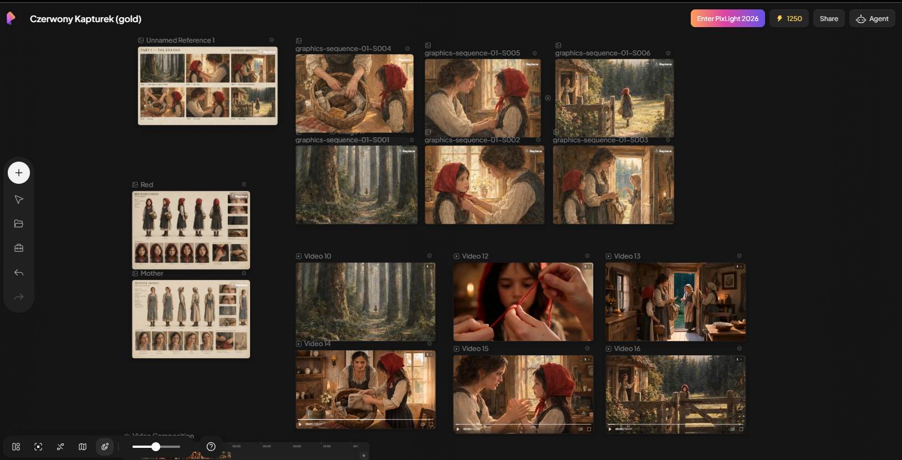

# Little Red Riding Hood — A Storybook Film

A comprehensive visual storybook project for an animated adaptation of the classic fairy tale, organized as a creative knowledge base.

## Quick Preview



**View the project in motion:** [Pixverse AI Canvas](https://app.pixverse.ai/canvas/project/view/432361748284554)

## About This Project

This repository contains the complete production materials for *Little Red Riding Hood*:

- **Story Structure** — 42 scenes across 4 narrative parts
- **Character Bible** — detailed descriptions, costume, expressions
- **Location Bible** — environments, lighting, visual continuity
- **Cinematic Storyboard** — camera directions, pacing, visual language
- **Graphics Sequences** — AI-generated illustration prompts for each scene
- **Storyboard Layouts** — full scene details with narration, dialogue, and sound

## Folder Structure

```
production/
  ├── storybook/          — story structure, character & location references
  ├── sequences/          — graphics prompts organized by part
  └── storyboard.md       — complete scene-by-scene storyboard
```

## How to Use

1. **Review the story** — start with `production/storybook/B-story-structure.md`
2. **Character & location research** — explore character and place bibles
3. **Generate graphics** — use prompts from `production/sequences/` with AI image generators
4. **Build the storyboard** — reference `production/storyboard.md` for full scene details

## Creative Guidelines

- **Visual style:** Watercolor Scandinavian storybook aesthetic
- **Aspect ratio:** 16:9 (widescreen)
- **Color palette:** Warm earth tones, mist blues, forest greens
- **Tone:** Fairy tale wonder with subtle psychological depth

---

*A reimagining of a timeless story through visual narrative.*